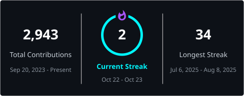

<!-- ═══════════════════════════ HEADER ═══════════════════════════ -->
<div align="center">


<a href="https://github.com/pranavsuri05">
  
</a>

<br/>

<a href="https://github.com/pranavsuri05"></a>
<a href="https://www.linkedin.com/in/pranavsuri1/"></a>

</div>

<br/>

## About

```ts
const pranav = {
  role:      "Final-year B.Tech CSE, Maharaja Agrasen Institute of Technology (GGSIPU)",
  graduation: 2027,
  cgpa:      "9.27 / 10",
  focus:     ["Multi-agent systems", "RAG", "LLM applications", "Backend APIs"],
  openTo:    "Software engineering and AI/ML internships",
};
```

<!-- ═══════════════════════ GITHUB ACTIVITY ═══════════════════════ -->
## Activity

<div align="center">

<!-- Contribution snake: generated nightly by .github/workflows/snake.yml into the `output` branch -->
<picture>
  <source media="(prefers-color-scheme: dark)" srcset="https://raw.githubusercontent.com/pranavsuri05/pranavsuri05/output/github-contribution-grid-snake-dark.svg" />
  <source media="(prefers-color-scheme: light)" srcset="https://raw.githubusercontent.com/pranavsuri05/pranavsuri05/output/github-contribution-grid-snake.svg" />
  
</picture>

<br/><br/>

<!-- Streak: generated nightly by .github/workflows/streak.yml into profile/streak.svg -->
<a href="https://github.com/DenverCoder1/github-readme-streak-stats">
  
</a>

<br/><br/>

<!-- GitHub stats cards use a public third-party instance (github-readme-stats).
     If it stops responding, deploy your own copy (github.com/anuraghazra/github-readme-stats)
     and replace github-readme-stats.vercel.app below with your deployment's host. -->


</div>

## Tech Stack

<div align="center">

**Languages & Backend**


<br/>


**AI / ML**


**Tools & Core CS**


</div>

## Featured Projects

<table>
  <tr>
    <td width="50%" valign="top">
      <h3>AI-SDLC Pipeline</h3>
      Multi-agent system that turns a Statement of Work into a BRD, HLD, user stories, LLD, QA test cases and a closure report. A deterministic context-reduction step cut the LLD stage's LLM input to roughly a quarter of its previous size.<br/><br/>
      
      
      <br/><br/>
      <a href="https://github.com/pranavsuri05/ai-sdlc">Repository →</a>
    </td>
    <td width="50%" valign="top">
      <h3>Razorpay Merchant Agent</h3>
      Merchant operations workspace with a WooCommerce connector architecture, order, product, inventory and customer management, and a natural-language merchant agent.<br/><br/>
      
      
      
      <br/><br/>
      <a href="https://github.com/pranavsuri05/razorpay-merchant-agent">Repository →</a>
    </td>
  </tr>
  <tr>
    <td width="50%" valign="top">
      <h3>IntelliDoc</h3>
      Offline PDF pipeline that rebuilds a document's heading hierarchy from font metadata and ranks sections for a persona using MiniLM sentence embeddings. Runs in Docker with no network access.<br/><br/>
      
      
      <br/><br/>
      <a href="https://github.com/pranavsuri05/IntelliDoc">Repository →</a>
    </td>
    <td width="50%" valign="top">
      <h3>F1 Race &amp; Performance Analytics</h3>
      End-to-end analysis of Formula 1 history: cleaned to 27,524 race-result records, analysed with SQL on SQLite across drivers, constructors, seasons and grid-to-finish trends, and visualised in Power BI.<br/><br/>
      
      
      <br/><br/>
      <a href="https://github.com/pranavsuri05/f1-race-performance-analytics">Repository →</a>
    </td>
  </tr>
</table>

## Achievements & Research

- **Winner**, AWS Hackathon
- **Finalist**, Adobe India Hackathon 2025
- **Semifinalist**, Flipkart GRID 8.0
- **Top 5 national finalist**, HackWithTricity
- **Co-author**, *Multi-Attribute Debiasing of LLMs via Bias-Aware Low-Rank Adaptation*, accepted at ICCCNet 2026 (Springer, Scopus-indexed)

<!-- ═══════════════════════════ FOOTER ═══════════════════════════ -->
<div align="center">

<br/>

<a href="https://www.linkedin.com/in/pranavsuri1/"></a>


</div>
